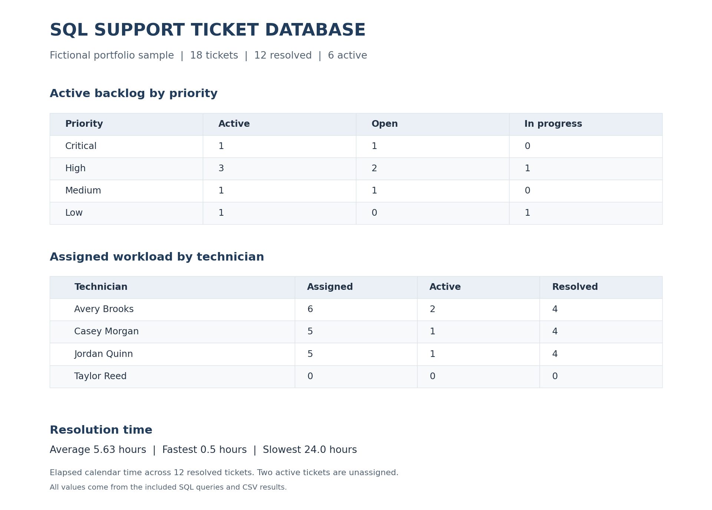
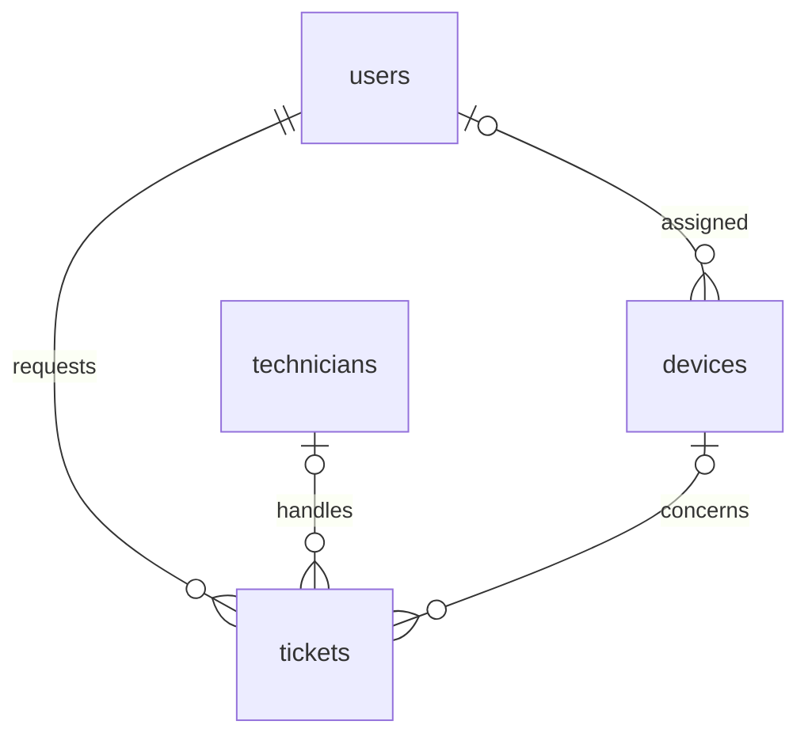

# SQL IT Support Ticket Database

A SQLite portfolio project for tracking IT support tickets, device inventory, technician assignments, and resolution times. It includes relational tables, reporting queries, documented checks, and a completed ticket-lifecycle example.

The original sample has **5 users, 4 technicians, 7 devices, and 18 tickets**. Twelve tickets are resolved, six are active, and two of the active tickets have no assigned technician. All sample names, emails, and incidents are fictional. The data is not from Miami-Dade County or a former employer.



## Completed ticket workflow

Ticket 16 starts as an unassigned software-installation request. In the completed exercise, it was assigned to Taylor Reed (technician 104), marked `In Progress`, and then marked `Resolved` with a sample completion timestamp and resolution notes. The saved SQLite Fiddle export is included as `practice/helpdesk_after_practice.sqlite3`.

| Measure | Original sample | Saved exercise |
| --- | --- | --- |
| Total tickets | 18 | 18 |
| Resolved tickets | 12 | 13 |
| Active tickets | 6 | 5 |
| Unassigned active tickets | 2 | 1 |
| Average elapsed resolution hours | 5.63 | 7.04 |

The completed ticket's elapsed time is 24 hours: October 5 at 12:00 to October 6 at 12:00 UTC. The average changes because that ticket is now included; this does not measure actual hands-on installation time.

- [SQL to reproduce the workflow](practice/ticket_16_workflow.sql)
- [Reports from the saved exercise](practice/REPORTS_AFTER_PRACTICE.md)
- [Saved-export verification](practice/VERIFY_EXPORT.md)

The main `reports/` folder and `helpdesk_demo.db` show the original sample. The `practice/` folder shows the completed exercise. Running `run_project.py` refreshes only the original sample outputs.

## Start here

1. Open `reports/report_preview.html` to view the finished report tables, or read `reports/REPORTS.md` on GitHub.
2. Read `docs/EXPLAIN_THE_SQL.md` and follow a ticket's IDs through the tables.
3. Run the project using one of the methods below.
4. Read `docs/TEST_RESULTS.md`, then try the small exercises in `docs/PRACTICE.sql`.

## Run it without installing anything

Open the official [SQLite Fiddle](https://sqlite.org/fiddle/index.html). Copy the contents of **`helpdesk_project.sql`** into its SQL input and execute the script in a **new, empty database**. It contains the schema, sample data, and all five report queries. This is SQL; paste it into a SQLite editor rather than a C++ source file.

The combined script is intended for one initial run per empty database. To repeat reports, execute just a query from `queries/`. To run the combined setup again, start with a fresh database.

## Run it locally with Python

Python 3 is needed for this option; the project uses its standard library and requires no pip packages. Open a terminal inside this extracted folder:

```text
py run_project.py
py test_project.py
```

On systems using the `python` command:

```text
python run_project.py
python test_project.py
```

`run_project.py` starts with the supplied sample data, writes `helpdesk_demo.db`, refreshes the five CSV reports, and creates the Markdown and HTML results. These files are generated sample outputs; keep your own database edits in a separate copy before rerunning the script. `test_project.py` uses an independent in-memory sample database for each test.

## What the reports answer

| SQL file | Question | Sample finding |
| --- | --- | --- |
| `queries/01_open_tickets_by_priority.sql` | Which priorities make up the active backlog? | Critical 1; High 3; Medium 1; Low 1 |
| `queries/02_tickets_per_technician.sql` | How many assigned tickets does each technician have? | Avery 6; Casey 5; Jordan 5; Taylor 0 |
| `queries/03_resolution_times.sql` | How many elapsed hours did each resolved ticket take? | Individual durations range from 0.5 to 24 hours |
| `queries/04_resolution_summary.sql` | What are the average, minimum, and maximum resolution times? | 12 resolved tickets; 5.63 average hours |
| `queries/05_unassigned_active_tickets.sql` | Which active tickets need a technician assignment? | Tickets 18 and 16 |

Active means `Open` or `In Progress`. Resolution time means elapsed calendar hours from ticket creation to resolution. Unresolved tickets do not contribute to the resolution average. Sixteen tickets have an assignment; the other two are listed separately in report 5. A technician with no assigned tickets remains visible in report 2.

## Database relationships



The IDs connect records. For example, ticket 2 links requester 4 (Chris Lee), device 5 (headset HS-001), and technician 102 (Jordan Quinn). Details live in their own tables rather than being copied into every ticket.

## Files

| File or folder | Purpose |
| --- | --- |
| `00_schema.sql` | Tables, relationships, validation constraints, and indexes |
| `01_sample_data.sql` | Reproducible fictional sample records |
| `queries/` | Five named reporting queries with comments |
| `helpdesk_project.sql` | Complete SQL script for an empty SQLite database |
| `helpdesk_demo.db` | Generated sample database, ready to inspect in a SQLite tool |
| `run_project.py` | Builds the sample and exports results |
| `test_project.py` | Checks report arithmetic and invalid-data behavior |
| `reports/` | Actual query output in CSV, Markdown, and HTML |
| `docs/DATA_DICTIONARY.md` | Field definitions and design choices |
| `docs/EXPLAIN_THE_SQL.md` | Beginner explanations and interview preparation |
| `docs/TEST_RESULTS.md` | Expected values, checks performed, and test results |
| `docs/PRACTICE.sql` | A reversible assignment/resolution exercise |
| `practice/ticket_16_workflow.sql` | Reproduces the completed assignment and resolution example |
| `practice/helpdesk_after_practice.sqlite3` | Verified database downloaded after completing the example |
| `practice/REPORTS_AFTER_PRACTICE.md` | All five reports queried from the downloaded database |
| `practice/VERIFY_EXPORT.md` | Integrity, relationships, and reproducibility checks for the saved export |

## How this relates to an IT specialist role

| Job responsibility | Evidence in this project |
| --- | --- |
| Assist with database logical design | Related tables, primary keys, foreign keys, and a data dictionary |
| Create code for reporting requirements | SQL backlog, assignment, and elapsed-time reports |
| Prepare program/system test data | Fictional records with assigned, unassigned, resolved, and active tickets |
| Test and debug program behavior | Checks for accurate totals, missing relationships, and invalid ticket updates |
| Maintain hardware inventory records | Device asset tags and user assignments |
| Prepare documentation | Setup instructions, commented queries, report definitions, and a test record |

## Practice and explain the SQL

Review the code and use these tasks to explain its behavior:

- Use `docs/PRACTICE.sql` to assign ticket 16, resolve it, and observe the changed totals.
- Write a query showing resolved ticket counts by category.
- Explain why report 2 uses `LEFT JOIN` and `COUNT(t.ticket_id)`.
- Explain why the two unassigned tickets are excluded from technician assignment totals.
- Show how a foreign key prevents a ticket from pointing to a nonexistent requester.

The sample incidents demonstrate the data model and ticket workflow; they do not establish that these incidents happened at a workplace.

## Scope and limitations

- This is a local database and reporting demonstration. It has no login system, web ticket-submission interface, or enforced application access roles.
- Reports reflect a snapshot of current status. The schema does not track reopening, assignment history, or status-change events.
- All supplied times are UTC. Elapsed time includes nights and weekends; business-hour schedules and service-level targets are outside this version.
- Ticket complexity varies, so the sample averages are descriptive figures rather than technician performance ratings.
- Schema constraints check that timestamp text is parseable by SQLite; this version has no separate user-facing date-validation form.

## References

- [SQLite foreign keys](https://www.sqlite.org/foreignkeys.html): enable them on every connection.
- [SQLite date/time functions](https://www.sqlite.org/lang_datefunc.html): `strftime('%s', ...)` expresses timestamps in seconds.
- [Python sqlite3](https://docs.python.org/3/library/sqlite3.html): local execution and database backup.

SQL dialect: SQLite. Report outputs are included so a reviewer can inspect the project without running it.
